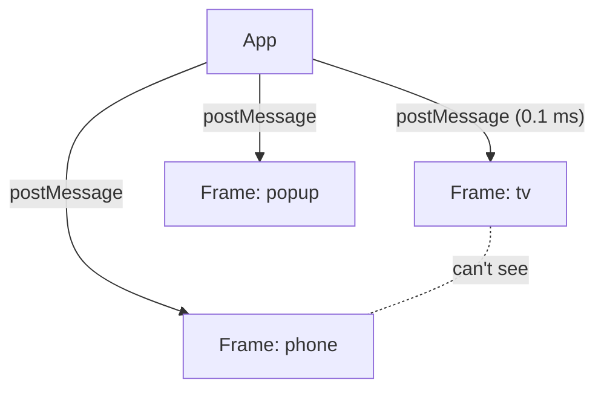

The canvas is an infinite floor where your designs stand around like very polite statues. Each statue is a **frame**.

## Frames are tiny websites in a box

Every frame is its own sandboxed `iframe`. That means a broken design can't break the app, a script in a frame can't read your other frames, and 80 of them still pan and zoom at the display's refresh rate (we measured, see [Speed](/docs/speed)).

Offscreen frames get `display:none`. They take a nap and wake up when you scroll back. (Unloading them completely was *worse*: waking up from scratch is grumpy.)

## Moving around

| Do this | Get this |
|---|---|
| Drag the background | Pan |
| Scroll / pinch | Zoom |
| <kbd>⌘0</kbd> | Fit everything |
| <kbd>⌘1</kbd> | Actual size (100%) |
| <kbd>Shift</kbd>+<kbd>2</kbd> | Zoom to the selected frame |
| Click the zoom readout | Jump to actual size |

## Selecting and editing

- **Click** an element to select it. **Shift-click** (on the canvas or in the Layers list) to select several. Local edits, Delete, drag and arrow-nudge then hit all of them as **one undo step**.
- <kbd>Enter</kbd> selects a child, <kbd>Shift</kbd>+<kbd>Enter</kbd> selects the parent. You can walk the whole tree without touching the mouse, like a very nerdy ghost.
- **Drag** a positioned element to move it. Press inside the selection to move, outside to pan.
- **Resize** with the round handle at the bottom-right of the selection.
- **Arrow keys** nudge by 1 px (<kbd>Shift</kbd> = 10 px). Hold the key and the presses merge into a single undo step, so undo doesn't take 40 presses to get back.
- <kbd>Delete</kbd> removes the selected element. The frame's root is protected, because deleting the entire design by sneezing is not a feature.

:::info Static elements don't drag
Drag and nudge need a positioned element (`left`/`top`). Static ones move with CSS `translate` for nudges. If something refuses to drag, that is why. Tell Say to position it, it'll understand.
:::

## Layers and Inspector

Two floating glass islands. **Layers** shows the selected frame's element tree, with an 👁 per row to hide/show (undoable). **Inspector** shows the selected element's properties and lets you edit them directly.

## Frame management

Double-click a frame's name to rename it (<kbd>Enter</kbd> commits, <kbd>Esc</kbd> cancels, and it's undoable). <kbd>⌘D</kbd> duplicates a frame. The **Frame ▾** menu holds presets (+ phone, + desktop, + tv), Export, Delete frame and Reset design. The last frame can't be deleted: a canvas needs *someone* to talk to.

## Undo and redo

<kbd>⌘Z</kbd> and <kbd>⌘⇧Z</kbd> undo and redo *everything*: element edits, Say changes, frame deletes, renames, discarded takes. Edits are stored as an operation log, so the history survives reloads and project-file exports. See [History](/docs/history).
