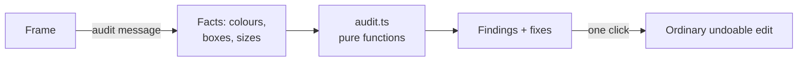

**Frame ▾ → Check frame** (or **Check all frames**) runs a critique pre-pass that is instant and costs zero Claude.

## What it catches

| Finding | Meaning |
|---|---|
| **contrast** | Text below 4.5:1 (3:1 for large text, ≥ 24 px) |
| **clipped** | Text cut off by its box (width or height) |
| **offscreen** | Text sitting outside the frame |
| **tap** | Interactive thing smaller than 44 px on phone / 24 px on desktop |
| **legibility** | On a TV: text under 24 px at 1920 wide (readable from a sofa, ~3 m) |
| **safe** | On a TV: text inside the 5% overscan margin, where TVs eat pixels |

Each finding names its element and, where there's one safe fix, offers a **one-click fix** (e.g. contrast → white or black, whichever reads better). The fix is an ordinary edit: undoable.

It's a pure function over facts the frame reports, so it's tested without a browser. On 24 frames it found 21 findings in 15 ms in e2e. Claude only gets asked about things that need *taste*, not arithmetic.

## Devices

Frames come in surfaces (TV, phone, desktop), and the checks adapt: phones care about thumbs, TVs care about sofas.

:::note 🚧 Planned lenses
**Prototype** (link frames into flows), full **Devices** views, **Motion** (timeline → MP4), **Effects** (WebGPU shaders with a frame budget) and a **3D** studio are designed and on the [roadmap](/docs/roadmap).
:::
