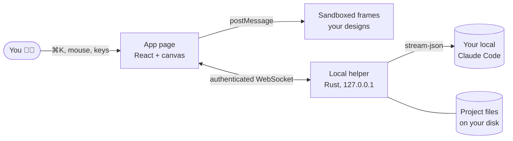

import Cards from '@site/src/components/Cards';

**Swift Canvas** is a design tool where you *talk* to your design instead of hunting through 47 nested menus for the "slightly rounder corners" checkbox.

You select something. You press <kbd>⌘K</kbd>. You type "make it pop". It pops. About a second later.

## The three promises

1. **Speed is the product.** Simple edits land in a few milliseconds, because they never leave your machine. Claude-sized edits start showing up in about a second.
2. **Your Claude, not ours.** Everything smart goes through the Claude Code login that is *already on your computer*. No API key to paste. No bill from us. We don't have a "we". (OK, we have a "we". It's a very small we.)
3. **It looks like glass.** Apple-style Liquid Glass UI, floating over a photo backdrop, with a contrast check so text stays readable even when the backdrop is a sunset.

## How the pieces fit

The app lives in a Chrome extension (or a dev web page). A small Rust helper on your machine does the things a browser is not allowed to do: talk to Claude Code, read repo folders, save project files. They chat over a WebSocket that checks both *who is asking* and a *secret token*. More in [Under the hood](/docs/under-the-hood).

## Pick your adventure

<Cards items={[
  {emoji: '🚀', title: 'Get it running', to: '/docs/getting-started', children: 'Five minutes, two terminals, zero API keys.'},
  {emoji: '🎨', title: 'Learn the canvas', to: '/docs/canvas', children: 'Frames, layers, selecting, moving, undoing your regrets.'},
  {emoji: '🗣️', title: 'Say things', to: '/docs/say', children: 'The speed trick: a local brain for easy edits, Claude for the rest.'},
  {emoji: '⚡', title: 'See the receipts', to: '/docs/speed', children: 'Real measured numbers. We wrote them down so we could not lie.'},
]} />

:::note A tiny honesty clause
Every page says what is **built**, what is **partly built** and what is **still a plan**. If a feature has a 🚧 next to it, it is on the roadmap, not in your app. We would rather disappoint you here than in the middle of a demo.
:::
