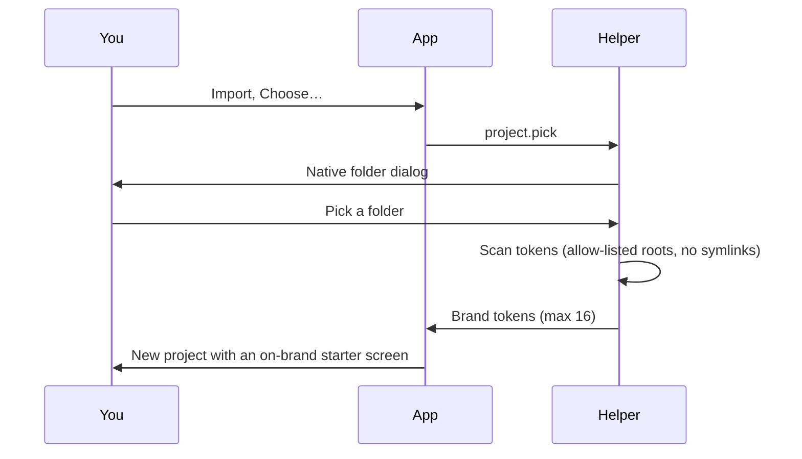

Swift Canvas is not a "design a landing page for a made-up coffee shop" tool. It's for **your actual projects**: a TV dashboard, a browser extension, a photo labeller, itself.

## The switcher

Top-left. Each project has its own frames, brand and history, plus little colour swatches so you can tell them apart. Switching flushes the autosave first, so nothing gets lost in transit.

## Import a project

**Import** opens a popover with a few doors:

| Door | What happens |
|---|---|
| **Choose…** | A native macOS folder picker (run by the helper). The folder you pick becomes an allowed root: consent by gesture. |
| **Scan a repo folder** | A scanner reads brand tokens (colours, radii, fonts) from your CSS custom properties |
| **From a screenshot** | The image goes through your local Claude Code, sanitised, into a starter design |
| **As project** | Creates a project from the scanned folder |
| **Save into a repo folder…** | Writes `<folder>/.swift-canvas/project.json` |

:::warning The scanner is paranoid, on purpose
Allow-listed roots only. No symlink following. A folder a page merely *names* is refused; only one *you picked in the dialog* is trusted. A web page can't talk the helper into reading `~/.ssh`.
:::

## "Use this brand"

Scanned tokens replace the hard-coded ones in every Say and Spark prompt, so "use the accent colour" means *your* accent colour. New projects start with an **on-brand starter screen** built from `bg / fg / accent / card / border` CSS variables, not a sad grey rectangle.

## Brand board

Edit a hex token and it changes across **all frames at once** (one undo step, kit included). Compare kits across projects, or share one token between them.

## The shared library

**Frame ▾ → Library.** Save the selection (markup plus where it came from), then insert it into any frame in any project. IDs are de-duplicated (`x`, `x-2`…) and the insert is one undo step. Room for 50 items of up to 20 KB each; ✕ removes one; origin chips filter by source project.

### Re-theme on insert ✨

Insert a card from *research-radar* into *tvdash* and it **puts on tvdash's clothes**: literal colours matching the origin's tokens become `var(--target-token, original)`, matched by name or role. In the e2e test a radar card landed in tvdash with "re-themed 2 colours".

## Portable project files

**Frame ▾ → Export project file / Open project file…**: a versioned JSON of name, frames, brand and (optionally) history. Opening *always creates a new project*, never overwrites, and refuses junk with a reason.

## Safety net: durable copies

Every autosave also backs up to the helper (`~/.swift-canvas/<id>.project.json`, atomic writes, size and JSON validated). A tab with no local copy restores from it. The web page and the extension share a project by id.
