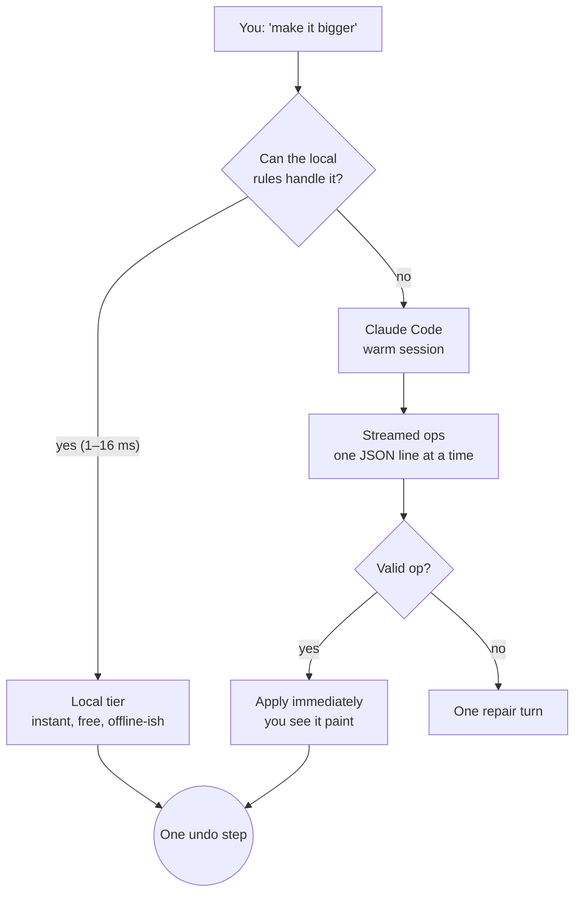

Say is the star. Select something, press <kbd>⌘K</kbd>, type what you want, hit <kbd>Enter</kbd>.

> "make the title bigger" · "dark theme" · "add a pricing card" · "make it feel like a Sunday morning"

## Two brains, one bar

The secret to the speed: **most requests don't need a genius.**

### Tier 1: the local rules (instant)

Things like *bigger, smaller, hide, show, opacity 50%, bold, italic, caps, underline, align, rounder, sharper, padding, border, colour, background, size* run on your selection with **no Claude call**. They take milliseconds. You can even say "change the accent to green" and it rewrites the brand token across *every* frame as one undo step.

The suggestion chips above the bar (**Bigger / Smaller / Bold / Hide** plus your brand colours) are the same engine with buttons on top.

### Tier 2: Claude (about a second)

Anything creative goes to a **warm** Claude Code session that the helper keeps ready, so there is no cold-start wait. Claude answers with *one JSON operation per line*, and each line is validated and applied the moment it arrives. You watch the design change while Claude is still typing.

The operations are a small, boring, safe language: `set`, `token`, `text`, `add`, `remove`, and `ask`.

:::tip Why not just let Claude call tools?
We measured. Streaming JSON as text gets the first visible change in **0.7–1.3 s**. Going through MCP tools took **1.3–2.7 s**. Same brain, slower hands. Tools are for heavy lifting; see [Ship → MCP](/docs/ship#let-claude-code-drive-the-canvas-mcp).
:::

## When Claude asks you a question

If your request is too vague ("make it nicer"), Claude may respond with an `ask` op. The question becomes the prompt; your answer is sent back with the original request. A conversation, but a short one.

## When Claude sends garbage

It happens. Invalid or malformed lines trigger **one** repair turn. If it still fails, you get a clear error instead of a silent shrug. Errors are reported, never swallowed. That's a house rule.

## Big frames

Frames over 6000 characters don't send a truncated tree; Say sends an **outline** of every element plus the selected element's full markup. A real 18 KB frame answered "make the text of item 70 red" in 1.4 s.

## Quality, with numbers

| Check | Result |
|---|---|
| 30 varied requests (Haiku, warm) | 29/30 valid |
| First visible change, p50 | ~1.15–1.24 s |
| Held-out set | 99/100 valid |
| Nightly eval against real Claude | 19/19 valid |

## History and keys

<kbd>↑</kbd>/<kbd>↓</kbd> in the bar recall earlier requests, like a terminal. <kbd>Esc</kbd> leaves the bar.

:::caution Running low on memory?
The helper checks free RAM before starting a new Claude process (default threshold 1200 MB). If your Mac is gasping, you'll get a friendly refusal instead of a frozen laptop.
:::
