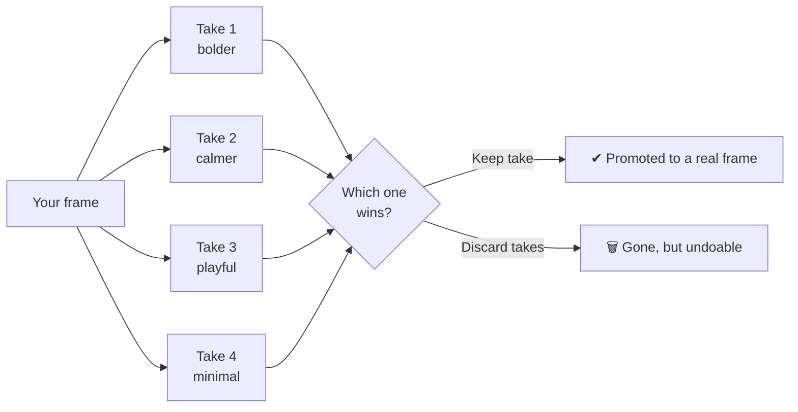

Say is "do this". **Spark is "surprise me, four times."**

Select a frame, click **Spark ×4**. Swift Canvas clones the frame into four *takes* in a grid above it, then runs four Claude sessions **in parallel**, each with a different design direction.

## Why it feels fast

- Each take is told to make **the single most visible change first**, then at most six more. First paint dropped from 4.5 s to about 2 s; all four done in roughly 3–5 s.
- While a take paints, it shows a shimmering skeleton, so you know it's alive and not ghosting you.

## The controls

| Action | What it does |
|---|---|
| **Keep take** | Promotes that take to a real frame |
| **Discard takes** | Removes the unreviewed ones. **Undoable.** |
| **Cancel Spark** | Stops all running takes (late results are dropped) |
| **Cancel this take** | Stops just one, the rest carry on |

There's a cap of **8 unreviewed takes** so your canvas doesn't turn into a yard sale.

## Where do the directions come from?

From local rules: 4 base directions plus 2 twists = 12 distinct prompts, project-agnostic (a TV dashboard and an email get equally weird ideas). No extra model call needed. In real runs the takes were genuinely different (a diversity score of about 0.57–0.83).

## Know the price before you click

Hover the button: the tooltip shows an **estimated token cost** (the average of your recent requests, or a measured default). It's not shown on the label itself because adding text pushed the toolbar 35 px too wide and the e2e test screamed. Tests are good dogs.

## Moodboard: directions from pictures

**Frame ▾ → Moodboard.** Paste an image, drop a file, or pick one. The colours are extracted and the prompt asks for the exact palette. In real-Claude testing, takes using the seeded colours went from **0/4 → 4/4**.

## Memory honesty

Each parallel session costs about **250 MB**. Twelve at once is about 3 GB. That's why there's a pool with a cap and idle shutdown, and the memory guard from [Say](/docs/say).

:::note 🚧 Coming
A visual side-by-side/onion-skin **Compare** and **branches** (named forks of your history) are designed, with the op-log foundation built, but the UI is still on the roadmap. See [History](/docs/history).
:::
