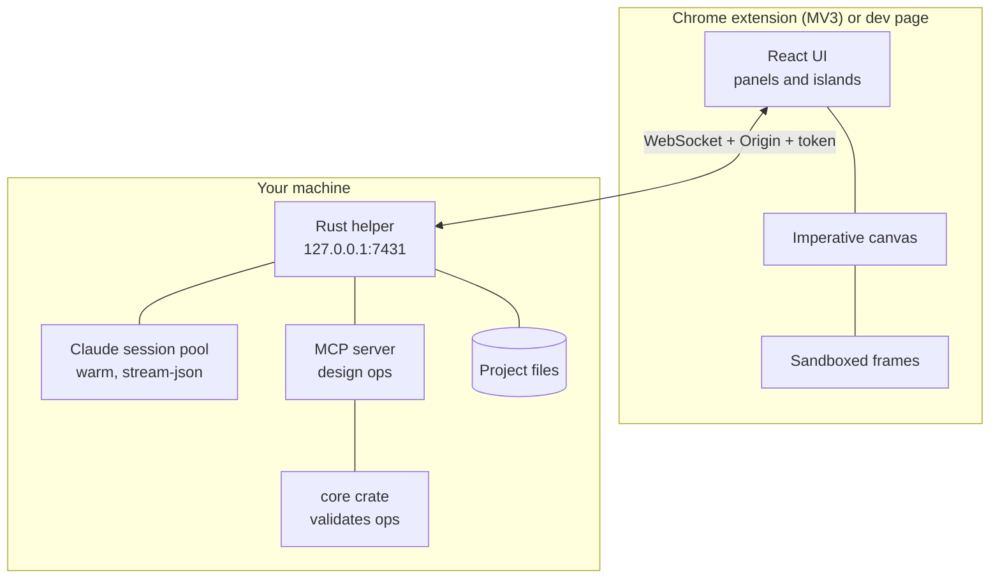

For the curious, the suspicious and the people who read terms and conditions.

## The cast

## The hard rules

1. **Local Claude Code login only.** No Anthropic API calls, no API key. Ever.
2. **Liquid Glass UI.**
3. **Speed is the product**: the app *and* the build/test loop.
4. **No language religion.** Each language earns its place by measurement.
5. **Quality bar**: failure modes listed and tested, errors reported not swallowed.

## Security: the helper is a bouncer

- Listens on `127.0.0.1` only.
- Every WebSocket must pass **Origin check + secret token**. A random web page fails the Origin check; browsers always send the Origin and pages can't fake it.
- Folder access is allow-listed; symlinks are not followed.
- Ids, sizes and JSON are validated before anything is written; writes are atomic.
- The memory guard refuses new Claude processes when RAM is low.

## Why a Rust helper *and* TypeScript?

We measured instead of arguing:

| Task | TypeScript | WASM/Rust | Verdict |
|---|---|---|---|
| Re-theme 5,000 nodes | 2.5 µs | 2.7 µs | tie |
| 20k-node property diff | 514 µs | 28 µs (12 with SIMD) | Rust wins, but it's microseconds |
| Hit-test 20k nodes | 64 µs | 47 µs | meh |

So: **TypeScript for UI, document and tokens; Rust for the helper and bulk work.** The `core/` crate validates every op batch arriving over MCP; the renderer deliberately doesn't use it. Shipping WASM was deferred until a project is big enough to need it (~100k nodes).

## Why not build on tldraw?

Paid licence plus a watermark for production, and no evidence it handles HTML shapes the way frames need. So: no.

## Why a warm Claude?

Cold start costs seconds. The helper keeps a **spare** session prewarmed (on connect and on focus), serves your Say from it, and starts a replacement. Idle ones are reaped. A dead spare falls back cleanly.

## Extension gotcha, for the history books

Inline `srcdoc` frames inherit the extension page's CSP, so their bridge script is blocked. In the extension, frames are the manifest **sandbox page** `frame.html`, receiving the design via a `load` message; the dev page uses inline srcdoc. A test guards the two copies against drift.
